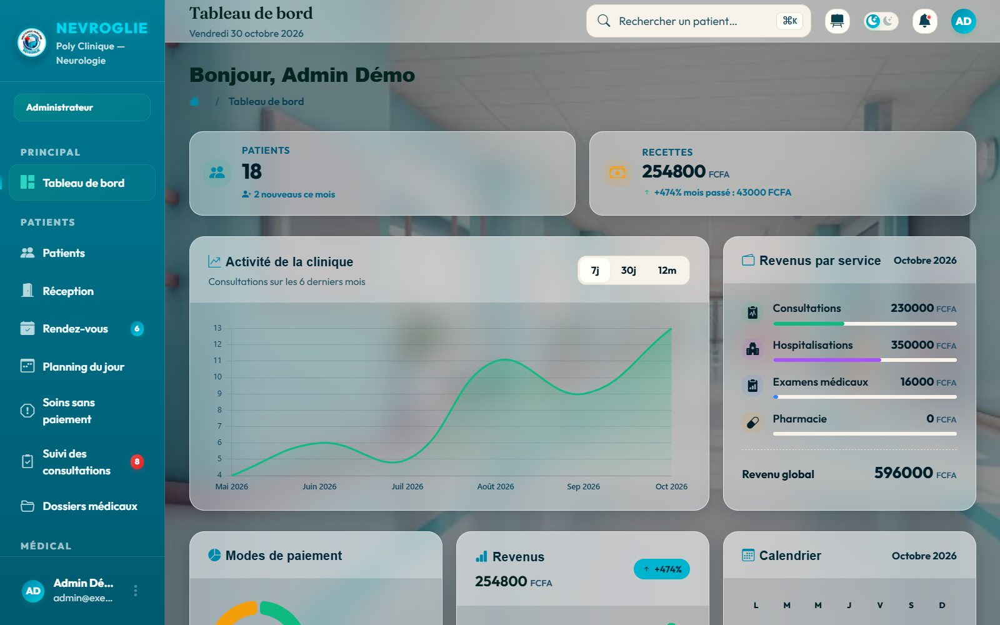
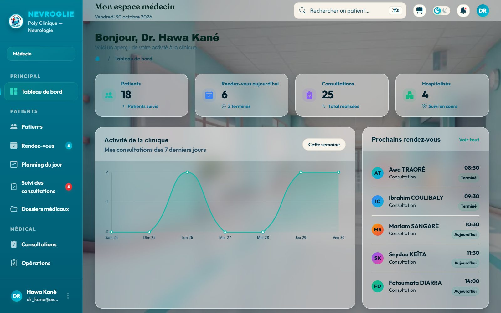
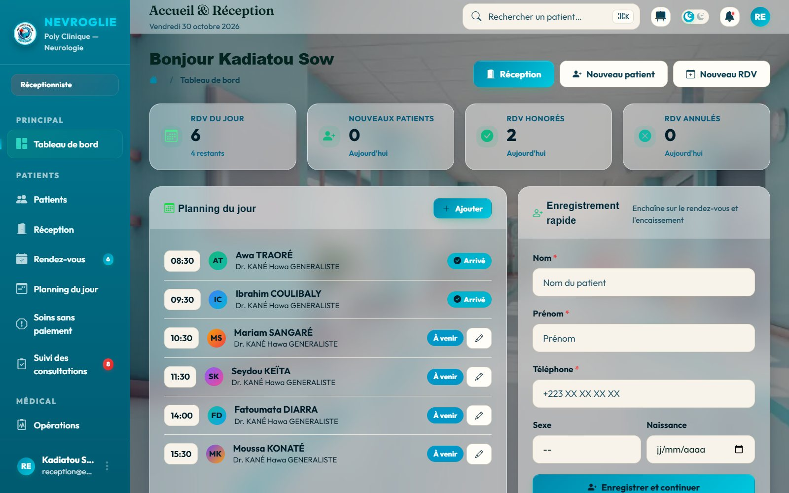
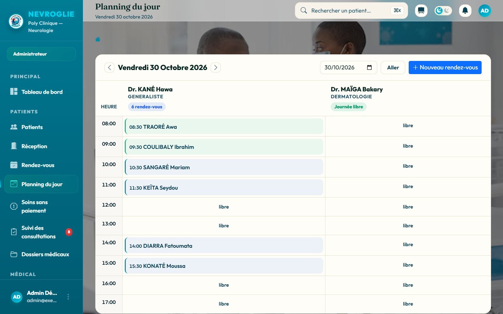
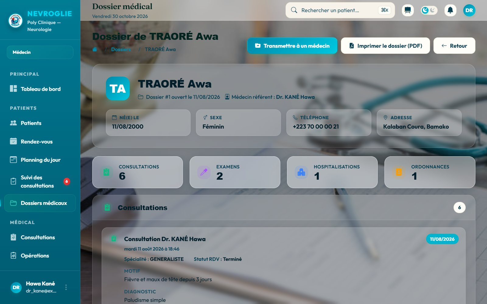
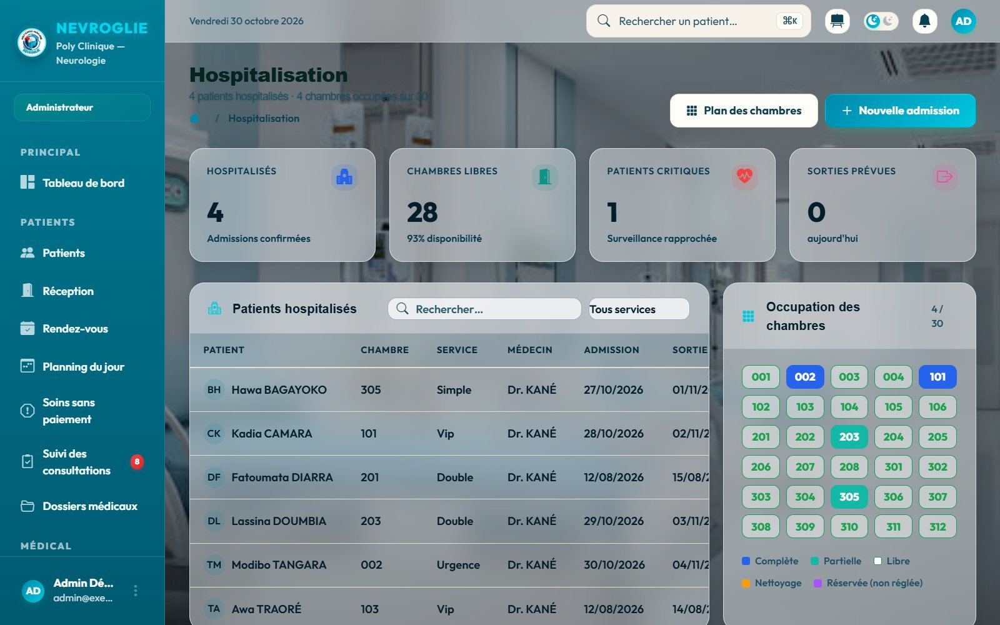
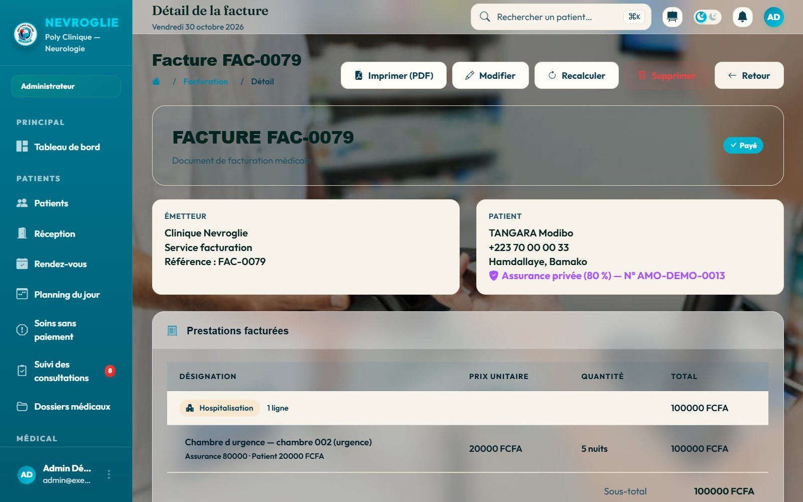
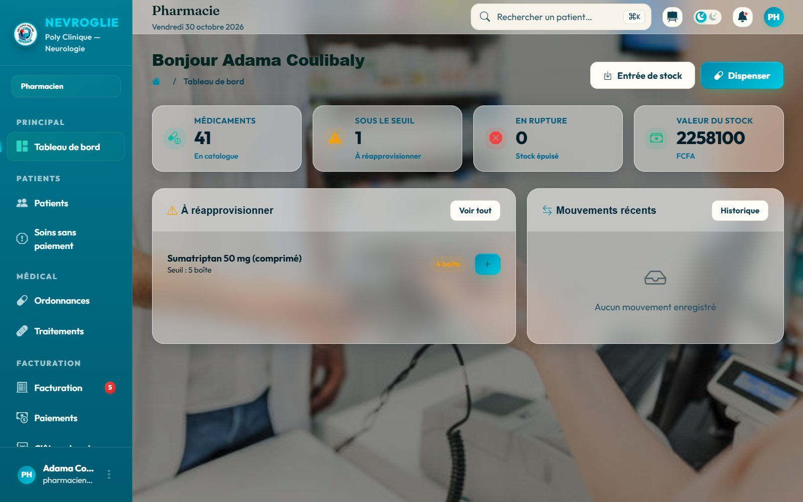
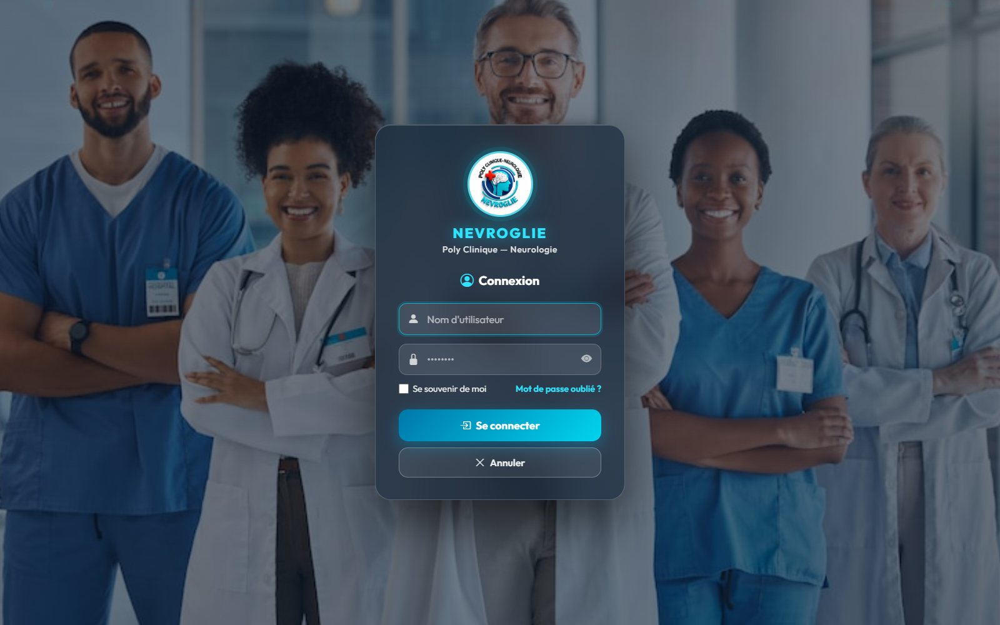

# Nevroglie — Logiciel de gestion de clinique


Application web qui gère **tout le parcours du patient** dans une clinique :
l'accueil, les rendez-vous, la consultation, le laboratoire, l'hospitalisation,
la pharmacie et la facturation avec prise en charge par l'assurance.

Chaque métier a son propre espace : administrateur, médecin, infirmier,
laborantin, réceptionniste et pharmacien. Chacun ne voit que ce qui le concerne.

Projet de fin de cycle — Licence MIAGE, Université Technolab ISTA, Bamako (2026).



> Les captures ont été prises sur une **base de démonstration** : tous les
> patients, médecins et montants qui y figurent sont fictifs.

## Aperçu

<table>
  <tr>
    <td width="50%"><br><sub><b>Espace médecin</b> — rendez-vous du jour, activité, patients hospitalisés</sub></td>
    <td width="50%"><br><sub><b>Réception</b> — planning du jour et enregistrement rapide d'un patient</sub></td>
  </tr>
  <tr>
    <td><br><sub><b>Planning du jour</b> — qui reçoit qui, médecin par médecin</sub></td>
    <td><br><sub><b>Dossier médical</b> — consultations, examens, hospitalisations, ordonnances</sub></td>
  </tr>
  <tr>
    <td><br><sub><b>Hospitalisation</b> — occupation des 30 chambres en temps réel</sub></td>
    <td><br><sub><b>Facturation</b> — part de l'assurance et part du patient, ligne par ligne</sub></td>
  </tr>
  <tr>
    <td><br><sub><b>Pharmacie</b> — stock, seuils de réapprovisionnement, dispensation</sub></td>
    <td><br><sub><b>Connexion</b> — « se souvenir de moi » et mot de passe oublié par e-mail</sub></td>
  </tr>
</table>

## Fonctionnalités

| Module | Ce qu'il fait |
|--------|---------------|
| **Accueil et réception** | Enregistrement des patients, rendez-vous, planning du jour par médecin, encaissement |
| **Espace médecin** | Consultations, prescriptions d'examens, ordonnances, traitements, opérations |
| **Dossiers médicaux** | Un dossier par patient, visible seulement par son médecin et les confrères avec qui il le partage ; export PDF |
| **Laboratoire** | Examens à réaliser, saisie des résultats, transmission au médecin avec notification |
| **Hospitalisation** | Plan fixe de 30 chambres (urgences, VIP, doubles, simples), capacité contrôlée, chambres d'urgence réservées aux patients critiques |
| **Urgences** | Admission sans identité connue ; soin accordé avant paiement, la dette restant suivie jusqu'au règlement |
| **Facturation** | Factures créées automatiquement, assurance (AMO) appliquée prestation par prestation, créances sur les assureurs, paiement en espèces ou SAMA Money, clôture de caisse, PDF |
| **Pharmacie** | Catalogue, stock par lots et dates de péremption, fournisseurs, commandes, alertes de seuil, dispensation liée aux ordonnances |
| **Administration** | 6 rôles, permissions configurables, journal d'audit, tableaux de bord par rôle |

## Points techniques

- **Règles métier centralisées** : toute la règle « on paie avant d'être soigné »
  tient dans un seul fichier, [`clinique/facturation/regles.py`](clinique/facturation/regles.py).
- **Performances** : les listes chargent l'état de paiement de tous leurs actes
  en une seule requête, sans problème « N+1 ».
- **Confidentialité** : un médecin n'ouvre que les dossiers médicaux de ses
  patients, ou ceux qu'un confrère lui a partagés ; l'accès est vérifié côté
  serveur, pas seulement masqué dans l'interface.
- **Tests** : 254 tests automatisés (`python manage.py test`).
- **Sécurité en production** : secrets lus dans des variables d'environnement,
  HTTPS forcé, cookies sécurisés et HSTS dès que `DEBUG` est désactivé.

## Stack technique

- **Back-end** : Python 3.14 · Django 6.0
- **Base de données** : SQLite par défaut, MySQL 8 pris en charge
- **Front-end** : templates Django · Bootstrap 5 · Chart.js
- **PDF** : ReportLab (factures, reçus, ordonnances, dossiers)

## Règle métier : le paiement précède l'acte

À la clinique Nevroglie, **on paie avant d'être soigné**. Trois actes sont
prépayés. Pour chacun, deux moments distincts : la facture est créée
**automatiquement** dès que l'acte est enregistré, et l'acte est **refusé**
tant qu'elle n'est pas soldée.

| Acte | La facture est créée quand… | L'acte est refusé tant que la facture n'est pas réglée |
|------|-----------------------------|--------------------------------------------------------|
| Consultation | la réception fixe le **rendez-vous** | le médecin ne peut pas enregistrer la consultation |
| Examen médical | le médecin prescrit l'examen | le laborantin ne peut pas saisir le résultat |
| Hospitalisation | le médecin enregistre l'admission | la chambre est réservée, le patient n'est pas admis |
| **Pharmacie** | **après** la dispensation — exception | rien n'est bloqué |

La pharmacie fait exception parce que le montant n'est connu qu'une fois les
médicaments servis.

Précisions :

- « Soldée » veut dire **toute la part patient encaissée**. La part prise en
  charge par l'assurance reste une créance sur l'assureur : un patient couvert
  à 100 % n'a rien à payer et n'est donc jamais bloqué.
- La consultation se facture sur le **rendez-vous**, pas sur la consultation :
  on ne peut pas encaisser un compte rendu qui n'existe pas encore.
- Modifier un acte refait sa facture. Rallonger un séjour de deux nuits
  re-bloque donc l'admission jusqu'au complément de paiement.

> Sur une base contenant déjà des rendez-vous, examens ou hospitalisations
> **sans facture**, ces actes deviennent impossibles à réaliser. La commande
> `python manage.py facturer_actes_existants` crée les factures manquantes
> (voir `--dry-run` pour simuler d'abord).

## Installation (développement)

```bash
# 1. Cloner puis créer l'environnement virtuel
python -m venv venv
venv\Scripts\activate          # Windows
# source venv/bin/activate     # Linux/macOS

# 2. Installer les dépendances
pip install -r requirements.txt

# 3. Appliquer les migrations
cd clinique
python manage.py migrate

# 4. Créer les rôles par défaut puis un compte admin
python manage.py setup_roles
python manage.py createsuperuser

# 5. Lancer le serveur
python manage.py runserver
```

L'application est alors disponible sur http://127.0.0.1:8000/.

**Votre base démarre vide**, et c'est voulu : `db.sqlite3` n'est pas versionné
parce qu'il contient de vraies données de patients et des comptes
utilisateurs. Après le `setup_roles`, connectez-vous avec votre compte admin
et créez de quoi travailler — au minimum un médecin, un tarif de consultation
et un patient.

Deux pièges qui ont déjà fait perdre du temps :

- **N'installez pas `mysqlclient`** tant que vous n'en avez pas besoin. Le
  projet tourne sur SQLite par défaut ; ce pilote réclame un compilateur C
  sous Windows et fait échouer toute l'installation. Il est commenté dans
  `requirements.txt`, laissez-le ainsi.
- **Une seule branche : `main`.** Tout le travail s'y trouve. Faites
  `git pull` avant de commencer *et* avant de pousser.

## Configuration (variables d'environnement)

Par défaut, le projet fonctionne en mode développement sans configuration.
Pour la **production**, définir les variables suivantes (jamais en clair dans
le dépôt) :

| Variable | Rôle | Défaut (dev) |
|----------|------|--------------|
| `DJANGO_SECRET_KEY` | Clé secrète Django | clé de dev (à régénérer) |
| `DJANGO_DEBUG` | Mode debug (`False` en prod) | `True` |
| `DJANGO_ALLOWED_HOSTS` | Hôtes autorisés, séparés par des virgules | `localhost,127.0.0.1` |
| `DJANGO_CSRF_TRUSTED_ORIGINS` | Origines HTTPS de confiance | *(vide)* |
| `DJANGO_TIME_ZONE` | Fuseau horaire | `Africa/Bamako` |
| `GMAIL_USER` / `GMAIL_APP_PASSWORD` | SMTP pour la réinitialisation de mot de passe | — |
| `SAMA_MONEY_CLE_API` | Clé de l'API de paiement SAMA Money | *(vide → mode démonstration)* |

> En production (`DJANGO_DEBUG=False`), le durcissement de sécurité s'active
> automatiquement (HTTPS forcé, cookies sécurisés, HSTS, anti-clickjacking).

Les secrets locaux peuvent aussi être placés dans
`clinique/clinique/local_settings.py` (non versionné).

## Tests

```bash
cd clinique
python manage.py test
```

## Structure des applications

| App | Rôle |
|-----|------|
| `comptes` | Authentification, rôles, permissions, notifications, journal d'audit |
| `patients` | Dossiers patients et assurance |
| `personnel` | Médecins, infirmiers, laborantins, réceptionnistes, pharmaciens |
| `consultation` | RDV, consultations, examens, résultats, ordonnances, hospitalisations, urgences |
| `facturation` | Tarifs, factures, paiements, part assurance (AMO), clôture de caisse |
| `pharmacie` | Médicaments, lots, fournisseurs, commandes, dispensation |

## Réalisation

Développé par **Aicha Dembélé** dans le cadre d'un projet de fin de cycle
en équipe — Licence MIAGE, Université Technolab ISTA, promotion 2023-2026.

GitHub : [@Aicha-Dembele](https://github.com/Aicha-Dembele)
